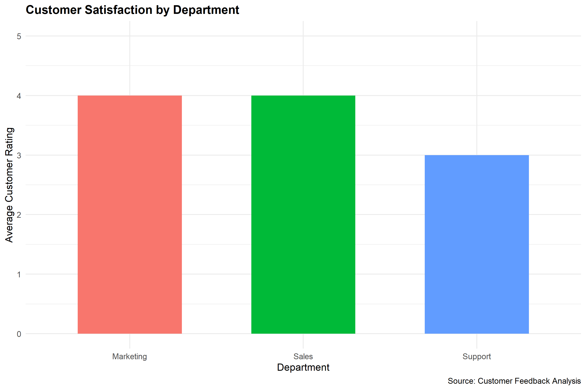

This project analyses customer feedback
to understand customer satisfaction.

## Objectives
- Measure customer satisfaction.
- Analyse customer ratings.
- Identify common customer complaints.
- Present findings using visualisations.

## Tools
- R Programming
- RStudio
- dplyr
- ggplot2

## Skills
- Data analysis
- Data cleaning
- Data visualisation
- Statistical reporting
# CUSTOMER SATISFACTION BY DEPARTMENT

# Calculate average rating for each department

department_satisfaction <- aggregate(
  Rating ~ Department,
  data = customer_feedback,
  FUN = mean
)

# Display department satisfaction
print(department_satisfaction)

# Calculate number of customers per department

customer_count <- table(customer_feedback$Department)

print(customer_count)

# Identify overall satisfaction level

if (average_rating >= 4) {
  print("Overall customer satisfaction is high")
} else if (average_rating >= 3) {
  print("Overall customer satisfaction is moderate")
} else {
  print("Overall customer satisfaction is low")
}
# CUSTOMER SATISFACTION BAR CHART

# Install ggplot2 if not already installed
if (!requireNamespace("ggplot2", quietly = TRUE)) {
  install.packages("ggplot2")
}

library(ggplot2)

# Create bar chart
satisfaction_chart <- ggplot(
  department_satisfaction,
  aes(x = Department, y = Rating, fill = Department)
) +
  geom_col(width = 0.6) +
  labs(
    title = "Customer Satisfaction by Department",
    x = "Department",
    y = "Average Customer Rating",
    caption = "Source: Customer Feedback Analysis"
  ) +
  theme_minimal() +
  theme(
    legend.position = "none",
    plot.title = element_text(face = "bold")
  ) +
  ylim(0, 5)

# Display chart
print(satisfaction_chart)

# Save chart
ggsave(
  "customer_satisfaction_chart.png",
  plot = satisfaction_chart,
  width = 9,
  height = 6,
  dpi = 300
)
## Customer Satisfaction Visualization

The chart below shows average customer satisfaction
ratings across different departments.

