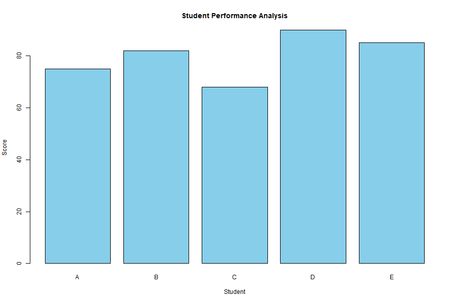

# Student Performance Analysis

## Objective
Analyze sample student scores using R.

## Analysis
- Calculate the average score.
- Identify the highest score.
- Identify the lowest score.
- Visualize scores using a bar chart.

## Tools
- R
- RStudio
- GitHub

## Data
This project uses fictional student data for practice.
## Student Performance Chart

